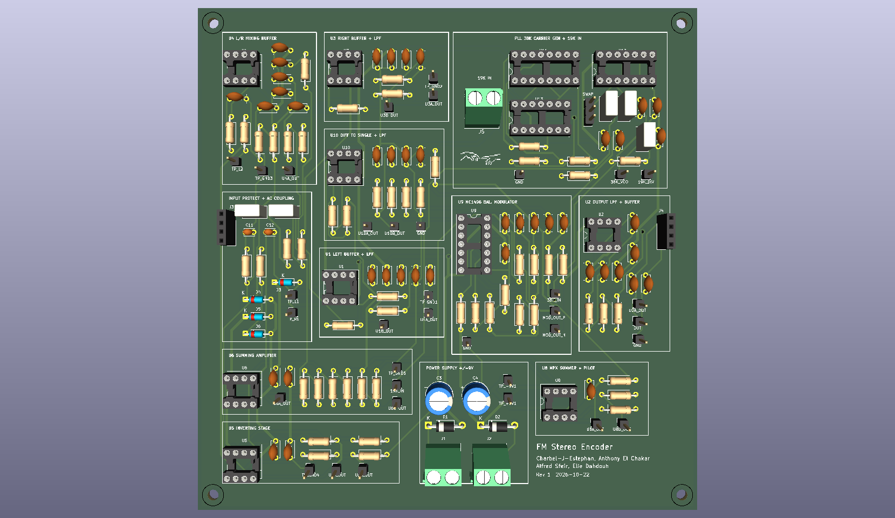
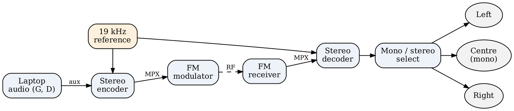
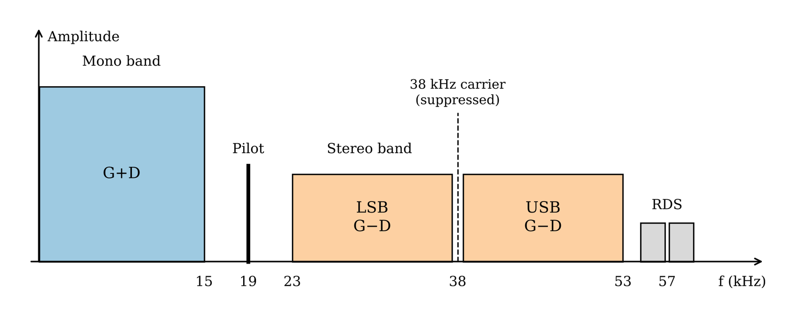
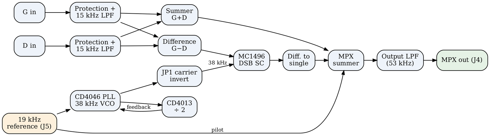
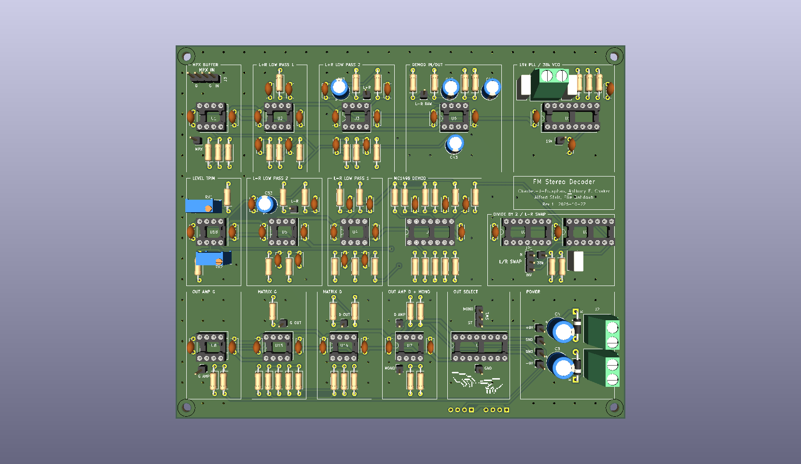
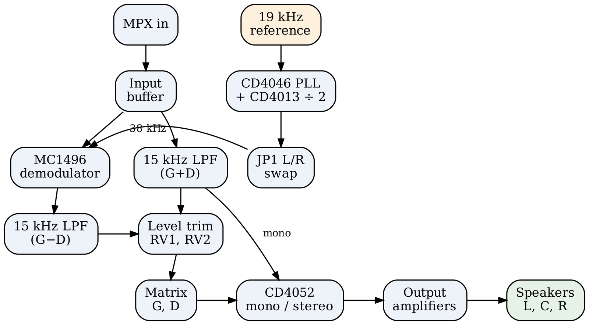
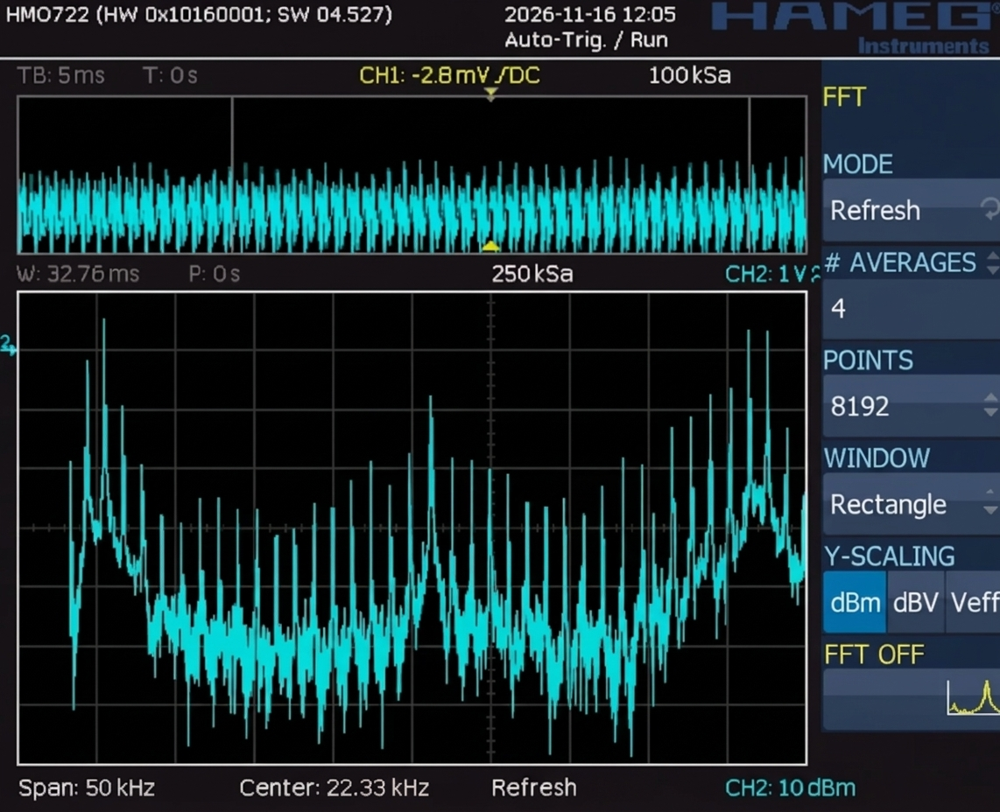

# FM Stereo Encoder and Decoder

An FM stereo transmission system that stays compatible with mono receivers. The encoder turns a left (G) and right (D) audio signal into one stereo multiplex (MPX) signal that drives an FM modulator. The decoder takes the received MPX and rebuilds G and D.

Communication Systems project, Notre Dame University Louaize.





## How it works

The encoder sends three things at once.

| Part                                 | Frequency       | Purpose                                       |
| ------------------------------------ | --------------- | --------------------------------------------- |
| G + D                                | 30 Hz to 15 kHz | What a mono receiver plays                    |
| 19 kHz pilot                         | 19 kHz          | Tells a stereo receiver to decode             |
| G − D on a suppressed 38 kHz carrier | 23 to 53 kHz    | The extra information a stereo receiver needs |



A mono receiver keeps only the band below 15 kHz, so it plays G + D. A stereo receiver locks to the pilot, doubles it to 38 kHz, recovers G − D and then rebuilds G and D.

## Repository layout

```
Encoder/    KiCad project, exports and report for the encoder board
Decoder/    KiCad project and exports for the decoder board
docs/img/   Images used in this README
```

### Encoder

| File                                            | What it is                         |
| ----------------------------------------------- | ---------------------------------- |
| `Encoder.kicad_pro`, `.kicad_sch`, `.kicad_pcb` | KiCad 10 project                   |
| `MC1496.kicad_sym`, `R0.kicad_sym`              | Symbol libraries the project needs |
| `Encoder_Schematic_color.pdf`                   | Full schematic in colour           |
| `Encoder_PCB_top_1to1_color.pdf`                | Top side of the board at 1:1 scale |
| `Encoder_3D_top.png`                            | 3D render of the board             |
| `FM_Encoder_Buy_List.xlsx`                      | Parts list with prices             |
| `FM_Stereo_Report.docx`                         | IEEE format project report         |

Signal chain:



1. Input protection and AC coupling on both channels
2. TL072 buffers and Sallen Key low pass filters at 15 kHz
3. Sum (G + D) and difference (G − D) op amp matrix
4. CD4046 phase locked loop with a CD4013 divider, locked to an external 19 kHz reference, gives a 38 kHz carrier
5. MC1496 balanced modulator puts G − D on the 38 kHz carrier
6. MPX summer adds G + D, the modulated G − D and the pilot
7. NE5532 output low pass filters, then out on J4

Board facts:

- Runs from ±9 V on J1 and J2
- Audio in on J3 (pin 1 left, pin 2 right, pin 4 ground)
- 19 kHz reference in on J5
- MPX out on J4 (pin 1 signal, pin 4 ground)
- JP1 flips the carrier phase if left and right come out swapped
- About 149 by 150 mm, hand soldered, every IC in a socket, header pins as test points

### Decoder

| File                                            | What it is                         |
| ----------------------------------------------- | ---------------------------------- |
| `Decoder.kicad_pro`, `.kicad_sch`, `.kicad_pcb` | KiCad 10 project                   |
| `Decoder_Schematic_color.pdf`                   | Full schematic in colour           |
| `Decoder_PCB_top_1to1_color.pdf`                | Top side of the board at 1:1 scale |
| `Decoder_3D_top.png`                            | 3D render of the board             |



Signal chain:



1. NE5532 MPX input buffer
2. 15 kHz low pass cascade to recover G + D, which also feeds the mono output
3. CD4046 phase locked loop with a CD4013 divider regenerates the 38 kHz carrier from the 19 kHz reference
4. MC1496 demodulates G − D, followed by a second 15 kHz low pass cascade
5. RV1 and RV2 trim the levels, then a TL072 matrix forms G and D
6. A CD4052 switch selects stereo or mono, and TL072 stages drive the outputs

## Test results (encoder)

Measured on the assembled board in the lab.

| Check                              | Target        | Measured          |
| ---------------------------------- | ------------- | ----------------- |
| Supply rails                       | ±8.8 V        | +8.78 V / −8.80 V |
| Sum with both inputs joined        | 1.82 Vpp      | 1.80 Vpp          |
| Difference with both inputs joined | under 50 mVpp | 49.7 / 0 mVpp     |
| VCO locked to 19 kHz               | 38 kHz        | 38 kHz            |
| VCO tracking at 18.5 / 19.5 kHz    | 37 / 39 kHz   | 37 / 39 kHz       |
| DSB output, left only              | 3.5 to 8 Vpp  | 4.36 Vpp          |
| Mono audio at output               | 1.82 Vpp      | 1.90 Vpp          |
| Full MPX, left only plus pilot     | 2.5 to 5 Vpp  | 2.88 Vpp          |

Measured MPX output with 1 kHz on G and 2 kHz on D on the HMO722, with a 50 kHz span centred on 22.33 kHz. The upper trace is the time domain signal. The FFT below shows the two audio tones, the 19 kHz pilot and the lower sidebands of G − D near 36 and 37 kHz. The image was redrawn from a photo of the scope screen with an AI image tool for legibility.



The full table and the spectrum analysis are in `Encoder/FM_Stereo_Report.docx`.

## Opening the projects

Use KiCad 10. Open `Encoder/Encoder.kicad_pro` or `Decoder/Decoder.kicad_pro`. Keep the `.kicad_sym` files next to the encoder project.

## Team

- [charbel-j-estephan](https://charbel-j-estephan.com)
- Anthony El Chakar
- Alfred Sfeir
- Elie Dahdouh
